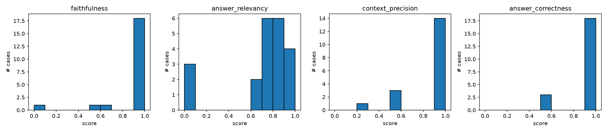
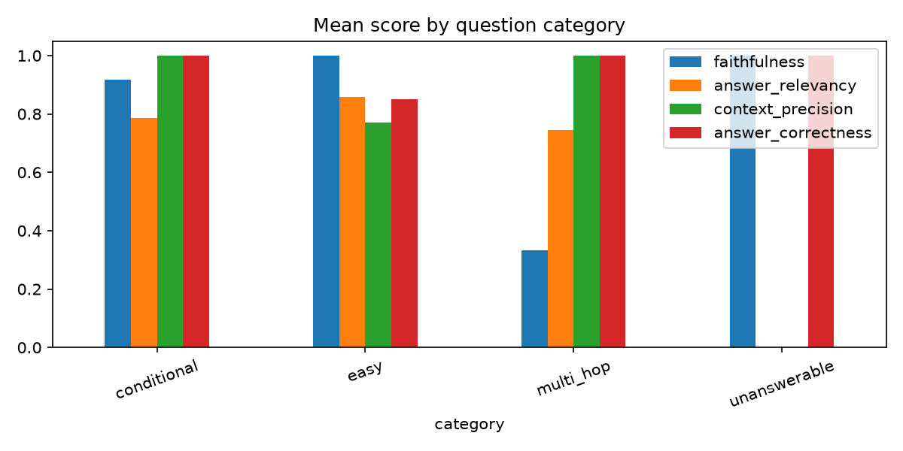

# LLM Evaluation Framework for a RAG Assistant

An automated evaluation framework for a retrieval-augmented generation (RAG) assistant that answers employee questions from 8 company policy documents. A script runs a 21-question test set through the assistant, scores every answer with LLM-as-judge metrics, aggregates the results, and analyses the worst failures. Scores are computed by code, not by eye.

## Results

Evaluated on 21 questions. Assistant and judge: Groq `openai/gpt-oss-120b`. Retrieval: top-k = 3.

| Metric | Mean | Median | Std | Min | Max |
|---|---|---|---|---|---|
| Faithfulness | 0.87 | 1.00 | 0.32 | 0.00 | 1.00 |
| Answer relevancy | 0.64 | 0.77 | 0.35 | 0.00 | 0.95 |
| Context precision | 0.86 | 1.00 | 0.29 | 0.00 | 1.00 |
| Answer correctness | 0.88 | 1.00 | 0.27 | 0.00 | 1.00 |
| Retrieval hit rate | 0.94 | 1.00 | 0.24 | 0.00 | 1.00 |

**By category (composite score):** conditional 0.91, easy 0.81, multi-hop 0.73, unanswerable 0.67.




**Key findings**
- Correctness (0.88), faithfulness (0.87) and context precision (0.86) are high, but the scores are skewed: the median is 1.00 and the minimum is 0.00, so most questions are answered perfectly and a few fail badly.
- Retrieval found the right document for 17 of 18 answerable questions.
- Answer relevancy is lowest (0.64), largely because it scores a correct refusal as 0, and 3 of the 21 questions are unanswerable. All 3 were correctly declined.
- Only one failure was a real pipeline problem (retrieval). Several of the lowest scores come from the metrics and reference answers, not from the assistant.

## Failure case analysis

### Case 10 (easy): retrieval failure
- **Question:** How much internet reimbursement do I get monthly?
- **Reference:** ₹1,000 per month, on submission of the bill.
- **App answer:** "I don't have enough information in the provided documents to answer that."
- **Retrieved sources:** learning.md, benefits.md, expenses.md
- **Cause:** The correct document (remote_work.md) ranked 5th by similarity (0.233), below the top-3 cutoff (0.298), so the model never saw the answer and correctly declined.
- **Why:** The top chunks discuss other reimbursements, which likely matched the word "reimbursement". The internet fact is one sentence inside a larger chunk, so its embedding may be diluted.
- **Fix (not tested):** Smaller chunks, higher top-k (5 would have included it), hybrid keyword and vector search, or query rewriting.

### Case 17 (multi-hop): metric artifact
- **Question:** I'm an L4 engineer with a base salary of ₹20,00,000 and a rating of 4. What is my target bonus?
- **App answer:** "Your target annual bonus is 15% of ₹20,00,000, which equals ₹3,00,000." (correct)
- **Scores:** faithfulness 0.0, correctness 1.0
- **Cause:** The judge marked both claims unsupported, because the salary comes from the question and the ₹3,00,000 figure is computed, so neither appears in the retrieved context. Faithfulness penalises correct reasoning.
- **Fix (not tested):** Give the judge the question as well, allow simple arithmetic from context facts, or weight correctness more for multi-hop questions.
- **Case 18** (6 weeks of remote work) shows the same pattern: faithfulness 0.33 with a correct answer.

### Cases 1, 5 and 6 (easy): over-specified references
- **Scores:** correctness 0.5 each, with the right document retrieved.
- **Cause:** The answers were correct on the fact asked. The judge deducted points for optional detail in my reference answers (accrual rate, manager approval, email address). In Case 6 the judge itself said the omitted detail was not required but still gave 0.5.
- **Fix (not tested):** Shorten references to the key fact, or tell the judge that extra reference detail is optional.

Full methodology and judge validation are in `FINAL_REPORT.md`.

## Metrics (how each is computed)

| Metric | What it measures | How it is computed |
|---|---|---|
| Faithfulness | Is the answer grounded in the retrieved context? | A judge splits the answer into claims and checks each against the context. |
| Answer relevancy | Does the answer address the question? | A judge writes 3 questions the answer would respond to; score is their mean embedding similarity to the real question. Refusals score 0. |
| Context precision | Are relevant chunks ranked high? | A judge marks each chunk useful or not; score is average precision. |
| Answer correctness | Does the answer match the reference? | A judge scores 0, 0.5 or 1 against the reference. |
| Retrieval hit | Was the right document retrieved? | Deterministic check against the gold source file. |

## Test set

`data/testset.json`: 21 questions (10 easy, 6 conditional, 2 multi-hop, 3 unanswerable) with reference answers and gold sources.

## Limitations

- 21 questions is a small sample; the multi-hop category has only 2.
- The same model was assistant and judge, which may cause self-preference bias.
- Answer relevancy scores correct refusals as 0; faithfulness penalises correct reasoning not stated verbatim in the context.
- Some reference answers contain more detail than the question requires.
- The proposed fixes were not tested.

## Run it yourself

```powershell
python -m venv .venv
.venv\Scripts\Activate.ps1
pip install -r requirements.txt
$env:PROVIDER="groq"
$env:GROQ_API_KEY="<your key>"
python run_eval.py
python analyze.py
```

## Project structure

`rag_app.py` (assistant), `judge.py` (metrics), `run_eval.py` (runs and scores), `analyze.py` (aggregates and report), `config.py`, `llm.py`, `data/` (documents and test set), `results/` (scores, charts, report).