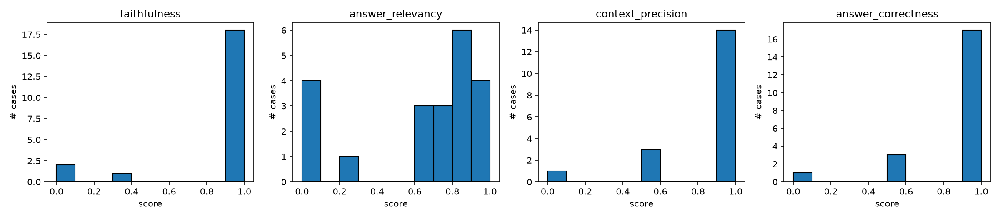
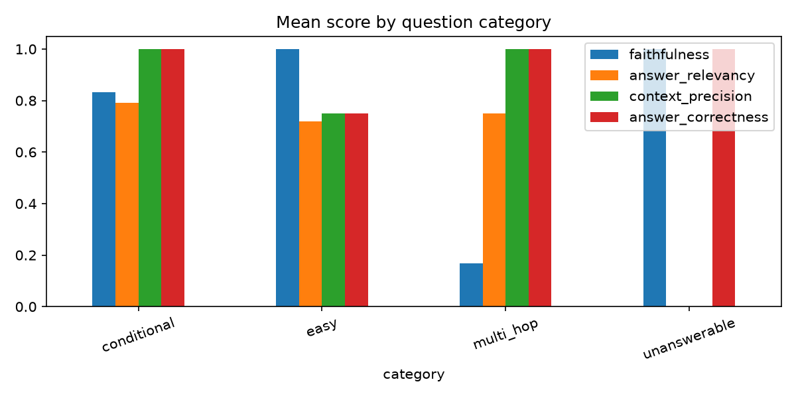

# Evaluation Report

- **Test cases:** 21
- **App model:** `openai/gpt-oss-120b`  |  **Judge model:** `openai/gpt-oss-120b`  |  **top-k:** 5
- **Mean latency per question:** 3.14s

## 1. Methodology

A fixed test set of real questions, each with a reference answer, is run through the RAG assistant. Every output is scored automatically by `run_eval.py` using these metrics:

| Metric | How it is computed |
|---|---|
| Faithfulness | An LLM judge splits the answer into atomic claims and checks each against the retrieved context. Score = share of supported claims. |
| Answer relevancy | An LLM writes 3 questions the answer would respond to; score = mean embedding cosine similarity to the real question. Refusals score 0. |
| Context precision | An LLM marks each retrieved chunk useful or not; score = rank-aware average precision. Skipped for unanswerable cases. |
| Answer correctness | An LLM compares the answer to the reference (0, 0.5 or 1). For unanswerable questions, declining is correct. |
| Retrieval hit | Deterministic: was the gold source document among the retrieved chunks? |

## 2. Aggregate results

|                    |   mean |   median |   std |   min |   max |   % cases >= 0.8 |
|:-------------------|-------:|---------:|------:|------:|------:|-----------------:|
| faithfulness       |  0.873 |    1     | 0.324 |     0 | 1     |             85.7 |
| answer_relevancy   |  0.639 |    0.771 | 0.348 |     0 | 0.948 |             47.6 |
| context_precision  |  0.861 |    1     | 0.287 |     0 | 1     |             77.8 |
| answer_correctness |  0.881 |    1     | 0.269 |     0 | 1     |             81   |
| retrieval_hit      |  0.944 |    1     | 0.236 |     0 | 1     |             94.4 |

### By question category

| category     |   faithfulness |   answer_relevancy |   context_precision |   answer_correctness |   retrieval_hit |   composite |   n |
|:-------------|---------------:|-------------------:|--------------------:|---------------------:|----------------:|------------:|----:|
| conditional  |          0.833 |              0.79  |                1    |                 1    |             1   |       0.906 |   6 |
| easy         |          1     |              0.718 |                0.75 |                 0.75 |             0.9 |       0.805 |  10 |
| multi_hop    |          0.167 |              0.749 |                1    |                 1    |             1   |       0.729 |   2 |
| unanswerable |          1     |              0     |              nan    |                 1    |           nan   |       0.667 |   3 |

## 3. Failure analysis (the 5 lowest-scoring cases)

Diagnoses below are auto-drafted from the scores. **Verify each one by hand** before submitting: read the question, retrieved sources and answer, then confirm or edit the cause.

### Summary of causes

- Metric artifact (correct refusal): 3 case(s)
- Retrieval failure: 1 case(s)
- Metric / judge artifact: 1 case(s)

### Case 10 (easy) - composite 0.25
- **Question:** How much internet reimbursement do I get monthly?
- **Reference answer:** ₹1,000 per month, on submission of the bill.
- **App answer:** I don't have enough information in the provided documents to answer that.
- **Retrieved sources:** learning.md, benefits.md, expenses.md
- **Scores:** faithfulness=1.00, relevancy=0.00, precision=0.00, correctness=0.00, retrieval_hit=0.00
- **Diagnosis:** Retrieval failure
- **Analysis:** The gold document was not among the retrieved sources (learning.md, benefits.md, expenses.md), so the model never saw the needed facts. Judge note: The answer does not provide the correct reimbursement amount (₹1,000 per month) and instead claims insufficient information, which contradicts the reference answer.
- **Proposed fix:** Increase TOP_K, use a stronger embedding model, add hybrid BM25 + vector search, or rewrite the query before retrieval.
- [ ] Verified by hand (edit the diagnosis above if it is wrong)

### Case 17 (multi_hop) - composite 0.66
- **Question:** I'm an L4 engineer with a base salary of ₹20,00,000 and a rating of 4. What is my target bonus?
- **Reference answer:** 15% of base for L4, i.e. ₹3,00,000; eligible because rating is 3 or higher.
- **App answer:** Your target annual bonus is 15% of ₹20,00,000, which equals **₹3,00,000**.
- **Retrieved sources:** performance.md, benefits.md, expenses.md
- **Scores:** faithfulness=0.00, relevancy=0.65, precision=1.00, correctness=1.00, retrieval_hit=1.00
- **Diagnosis:** Metric / judge artifact
- **Analysis:** The answer matches the reference (correctness 1.00). The low composite is driven by faithfulness, not by a wrong answer. Unsupported claims flagged by the judge: ['The target annual bonus is 15% of ₹20,00,000.', '15% of ₹20,00,000 equals ₹3,00,000.'].
- **Proposed fix:** Read the judge's verdicts by hand; tighten the judge prompt or use a larger judge model. Consider weighting correctness more heavily in the composite.
- [ ] Verified by hand (edit the diagnosis above if it is wrong)

### Case 19 (unanswerable) - composite 0.67
- **Question:** What is the company's policy on stock options (ESOPs)?
- **Reference answer:** NOT_IN_DOCS
- **App answer:** I don't have enough information in the provided documents to answer that.
- **Retrieved sources:** expenses.md, security.md, expenses.md
- **Scores:** faithfulness=1.00, relevancy=0.00, precision=n/a, correctness=1.00, retrieval_hit=n/a
- **Diagnosis:** Metric artifact (correct refusal)
- **Analysis:** The app correctly declined. The low composite comes from answer_relevancy = 0, because a refusal counts as non-committal.
- **Proposed fix:** Exclude answer_relevancy for unanswerable cases (or report them separately). No change to the app is needed.
- [ ] Verified by hand (edit the diagnosis above if it is wrong)

### Case 20 (unanswerable) - composite 0.67
- **Question:** How many days of bereavement leave do I get?
- **Reference answer:** NOT_IN_DOCS
- **App answer:** I don't have enough information in the provided documents to answer that.
- **Retrieved sources:** leave_policy.md, expenses.md, learning.md
- **Scores:** faithfulness=1.00, relevancy=0.00, precision=n/a, correctness=1.00, retrieval_hit=n/a
- **Diagnosis:** Metric artifact (correct refusal)
- **Analysis:** The app correctly declined. The low composite comes from answer_relevancy = 0, because a refusal counts as non-committal.
- **Proposed fix:** Exclude answer_relevancy for unanswerable cases (or report them separately). No change to the app is needed.
- [ ] Verified by hand (edit the diagnosis above if it is wrong)

### Case 21 (unanswerable) - composite 0.67
- **Question:** What is the office dress code?
- **Reference answer:** NOT_IN_DOCS
- **App answer:** I don't have enough information in the provided documents to answer that.
- **Retrieved sources:** benefits.md, expenses.md, leave_policy.md
- **Scores:** faithfulness=1.00, relevancy=0.00, precision=n/a, correctness=1.00, retrieval_hit=n/a
- **Diagnosis:** Metric artifact (correct refusal)
- **Analysis:** The app correctly declined. The low composite comes from answer_relevancy = 0, because a refusal counts as non-committal.
- **Proposed fix:** Exclude answer_relevancy for unanswerable cases (or report them separately). No change to the app is needed.
- [ ] Verified by hand (edit the diagnosis above if it is wrong)

## 4. Limitations

- The test set has only 21 questions, so averages are noisy and small differences are not meaningful.
- LLM judges can be wrong or inconsistent, especially smaller free-tier models; a sample of verdicts should be checked by hand.
- If the same model acts as app and judge, the judge may favour its own style (self-preference bias).
- Answer relevancy gives 0 to correct refusals, which understates performance on unanswerable questions.
- Reference answers were written by hand and may themselves contain errors.

## 5. Suggested improvements

- Change one variable at a time (for example TOP_K, chunk size, prompt wording), rerun, and compare before/after scores.
- Add a retrieval-similarity threshold so questions with no good match return a refusal.
- Grow the test set with more hard, multi-hop and unanswerable cases.
